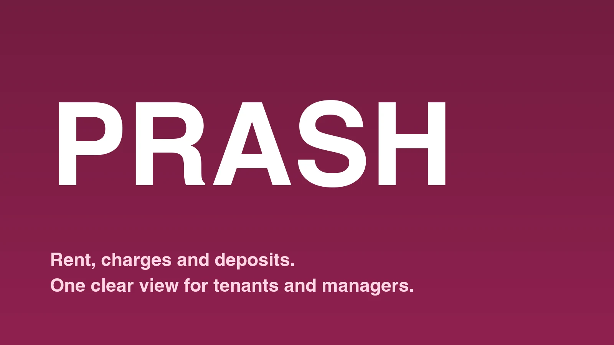
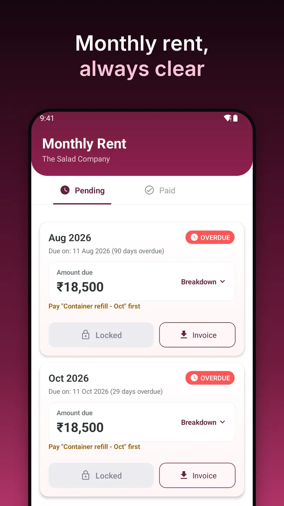
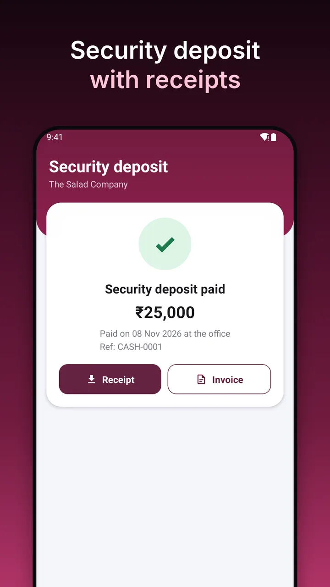
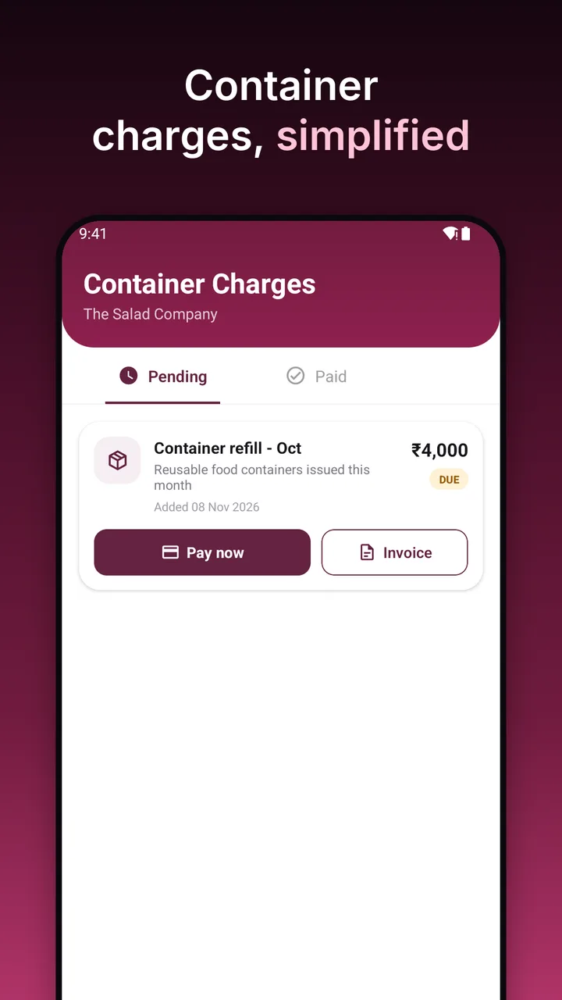
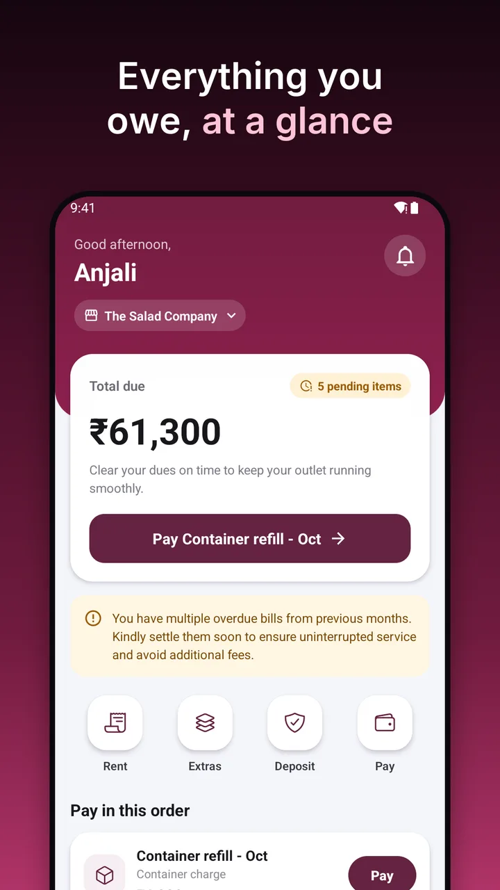
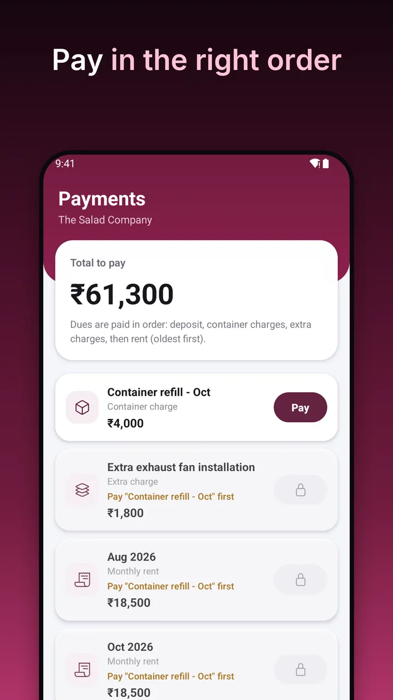
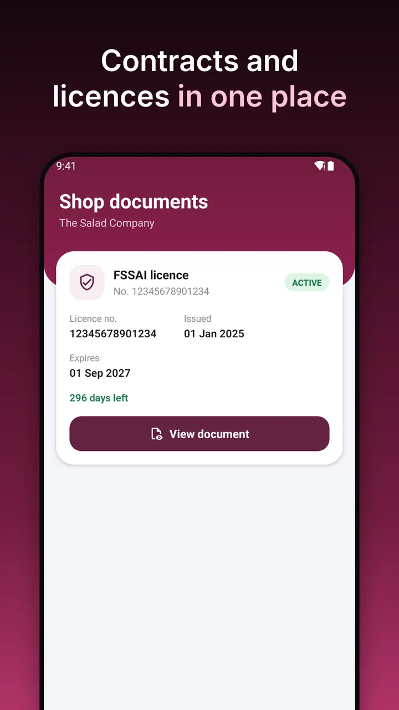

# Rent management software for food courts and shop tenants: PRASH

PRASH is rent management software that gives property managers and tenants one shared view of rent, charges, deposits, receipts and documents.

## What is PRASH rent management software?

PRASH is rent management software built for commercial properties with many small tenants: shops, outlets, kiosks and food courts. It is made for commercial properties only. Tenants use the PRASH mobile app. Property managers use a web dashboard. Both work from the same records, so there is one version of what is due, what has been paid and what is on file.

Built for one of India's largest private universities. PRASH looks after 100+ tenants and 100+ shops across 17 food courts and zones, including New Food Court, Greenzy Food Court, PU Containers, Capitol Crust, Utopian Feast Food Court, Canteen and Kiosk. Nearly 2,000 monthly rent bills have been raised through it since April 2025.

## Who PRASH is for

- **Commercial property owners** who rent out many shops or units and want less manual follow-up.
- **University and campus food courts** that lease outlets to vendors.
- **Mall and market managers** who bill rent and other charges to a mix of tenants.
- **Outlet tenants** who want to see what they owe and keep their receipts.

## How does commercial property rent management software help managers?

- **Less manual reconciliation.** Bills, charges and payments are recorded together, so there is less matching of lists by hand.
- **Simpler shop and outlet rent collection.** Each outlet gets its own bill, and tenants pay online from their phones.
- **Less chasing.** Tenants see their dues and get alerts in the app. Managers can see who has paid and who has not.
- **Control over who does what.** Admin accounts have different roles, and tax and penalty values are set in one place.
- **Reports when you need them.** GST and invoice GST reports, and a settlement report.

## Security deposit tracking and extra charges

A security deposit can be set for a property, requested from the tenant, and followed to payment, with its status shown on the property record. Extra charges and container charges are raised the same way, and the manager can view bill and charge transactions in one place. Each item has an invoice, and a receipt once it is paid.

## Rent invoices and receipts for every payment

Every bill and charge has a breakdown. Tenants can download or share a PDF invoice and receipt from the app, so nobody has to ask for copies. When a tenant and a manager discuss a charge, both can see the same amount, breakdown and receipt.

## How do tenants pay rent and other dues?

Tenants open the PRASH mobile app, see everything due in one list, and pay by UPI, cards or net banking, securely online. Dues are cleared in a set order: security deposit, container charges, extra charges, then rent. The app shows the result once the bank has confirmed it.

## Contracts, licences and reminders

Rental contracts and the FSSAI licence are kept in the app, marked Active, Expiring or Expired. For managers, an optional email digest can list defaulters, expiring contracts, FSSAI issues and security deposit risk.

## Getting started

For tenants, the property manager creates the account. You then install the PRASH mobile app and sign in with your email, or with Google using the same email address.

## Talk to us about using PRASH for your property

If you manage a food court, market or other commercial property and would like to know whether PRASH fits, get in touch. [TODO: add sales contact or enquiry link here]

Tenants who need help with their account can reach support at [+91 6202 781 773](tel:+916202781773) or [foodcourt.pu@paruluniversity.ac.in](mailto:foodcourt.pu@paruluniversity.ac.in), 9:30 am to 4:30 pm, Monday to Saturday. There is no support on University holidays.

## Frequently asked questions

**How do I collect rent from many shop tenants?**
Raise a bill for each outlet and let tenants pay online from their phones. The manager's dashboard shows which bills are paid and which are still due, so follow-up is limited to the ones that need it.

**How can I track security deposits?**
Set the deposit on the property record and ask the tenant to pay it in the app. The record shows whether it is pending or paid, and the tenant gets an invoice and a receipt.

**How can tenants get rent receipts?**
Once a bill is paid, the tenant can download or share the receipt from the app. Invoices are available the same way.

**Can tenants pay rent online in India?**
Yes. Payments are made online by UPI, cards or net banking, and the app shows the result after the bank confirms it.

**Can PRASH track expiring contracts and licences?**
Rental contracts and FSSAI licences are shown with Active, Expiring or Expired labels, and managers can receive an email digest of expiring contracts.

**Does PRASH handle charges other than rent?**
Yes. It covers extra charges, container charges and security deposits, each with its own invoice and receipt.

**Who can use PRASH?**
Property managers and tenants of properties set up in PRASH. Tenants cannot sign up on their own; the property manager creates each account.
