# PRASH tenant app: features in this update

Same artwork is used for Google Play and the App Store (`screenshots/play`, `screenshots/appstore-6.9`, `screenshots/appstore-6.5`). Raw captures are in `screenshots-raw/`; rebuild the framed slides with `python3 compose.py`.

| # | Feature | What the tenant gets | Screenshot |
|---|---------|----------------------|------------|
| 1 | Sign in | Email and password, or Continue with Google. Forgot password sends a 4-digit code that fills in from the clipboard. | 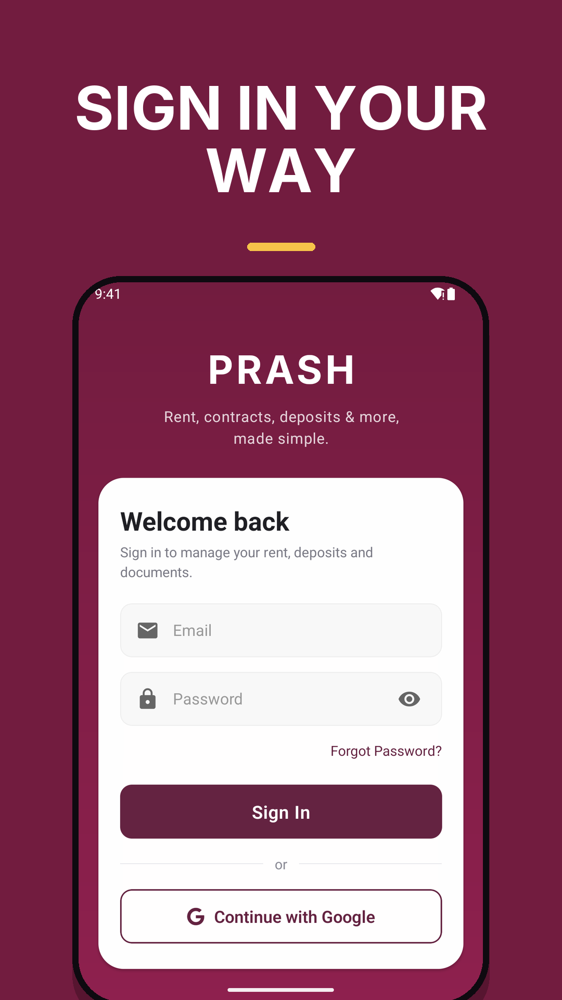 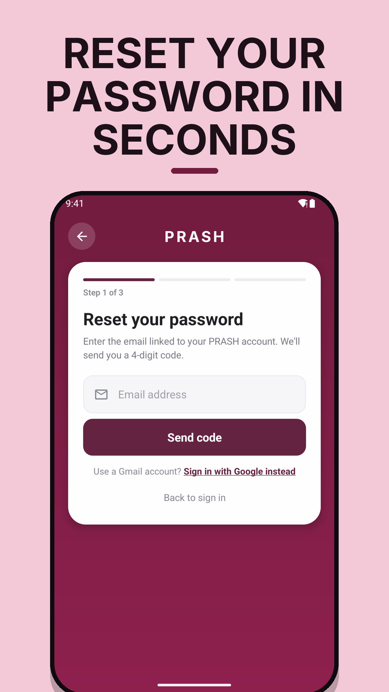 |
| 2 | Home | Total due, pending items, one-tap pay for the next item, shortcuts to Rent, Extras, Deposit and Pay, outlet switcher. | 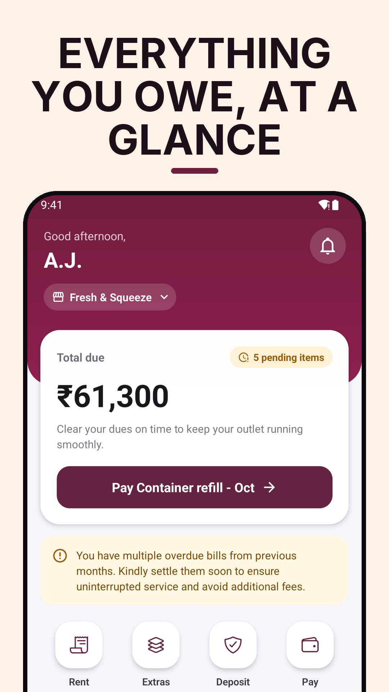 |
| 3 | Pay in order | One screen lists everything due in the required order: security deposit, container charges, extra charges, rent. Later items are locked with a note saying what to pay first. | 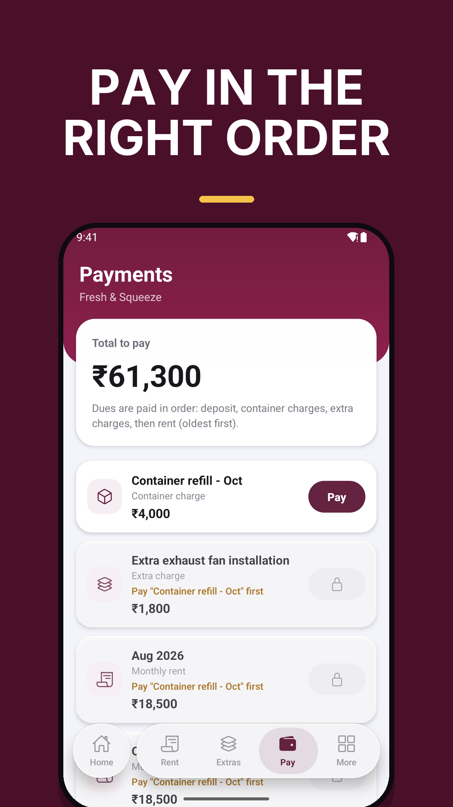 |
| 4 | Review & slide to pay | Every Pay button opens a review sheet. Slide to pay, then the app waits for the bank/gateway to confirm before showing success. Failed, cancelled and still-confirming states are explained, and a pending payment blocks a second attempt for 10 minutes so nobody is charged twice. | 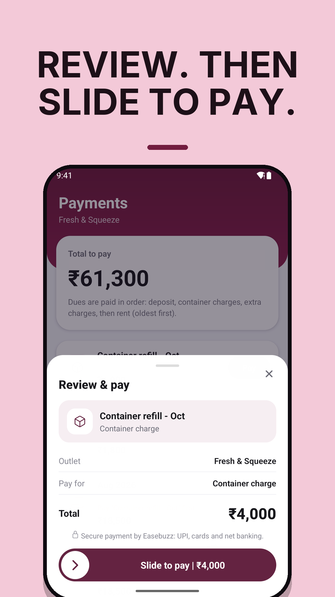 |
| 5 | Monthly rent | Due dates, status, breakdown, invoice and receipt PDFs. | 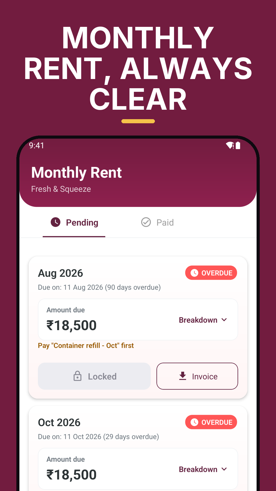 |
| 6 | Extra charges | Each charge with breakdown, invoice and receipt. | 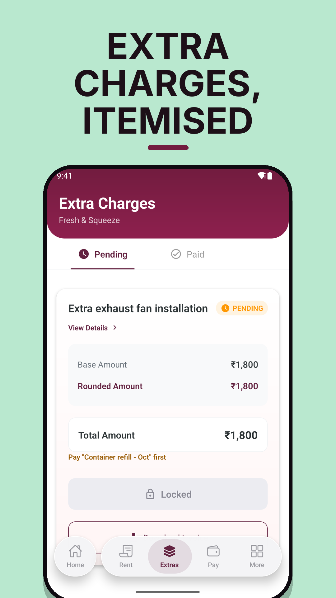 |
| 7 | Container charges | Pending and paid lists with Pay now, invoice and receipt. | 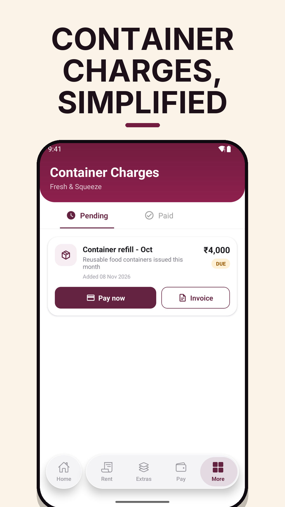 |
| 8 | Security deposit | Invoice when due, payment, receipt once paid. Other payments unlock after it is paid. | 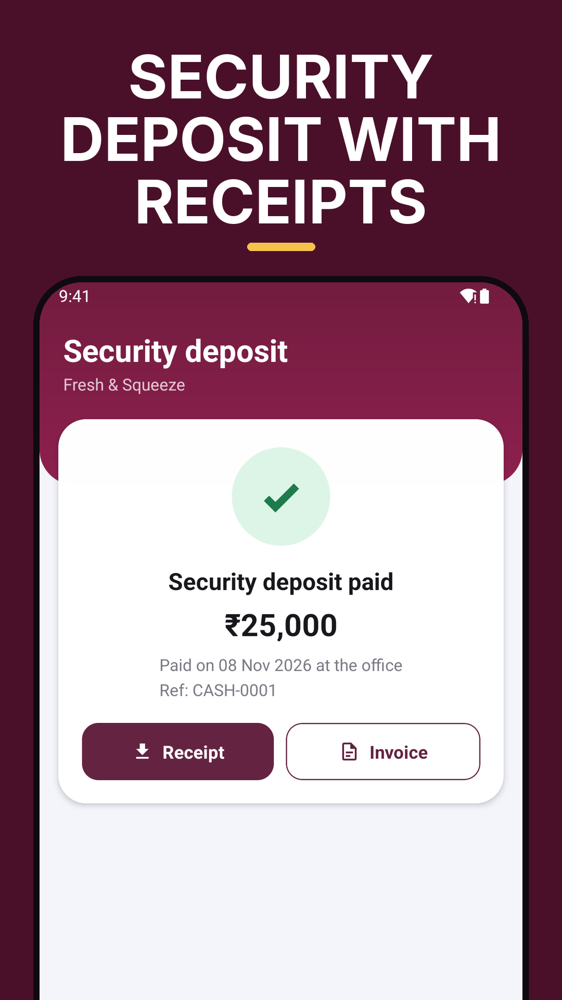 |
| 9 | Shop documents | Rental contracts and FSSAI licence with Active / Expiring / Expired labels and a View button. | 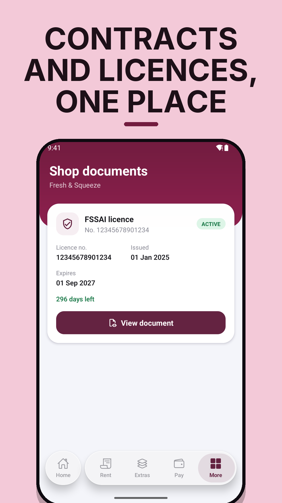 |
| 10 | Notifications | Categorised, tap to open the right page, older ones load as you scroll, white PRASH icon in the status bar. | 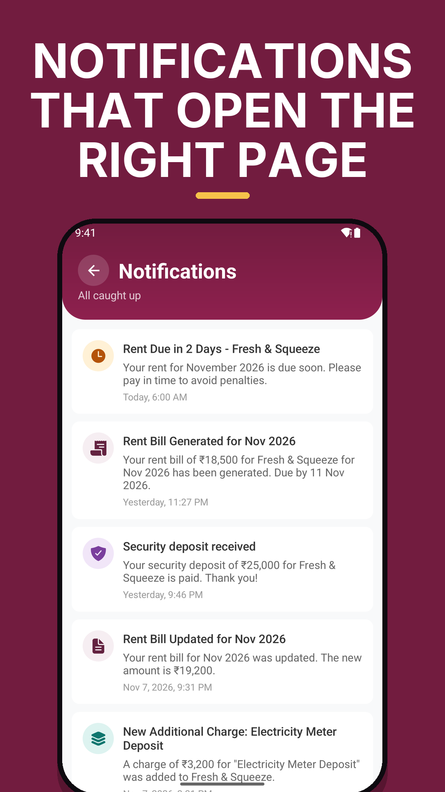 |
| 11 | Account | Details, bank, documents, help and sign out. | 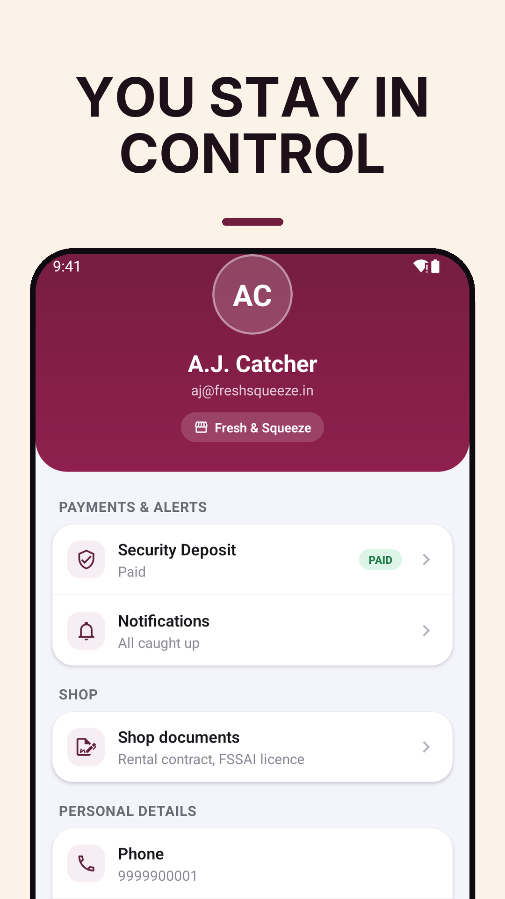 |
| 12 | More | Container charges, security deposit, shop documents and account one tap away. | 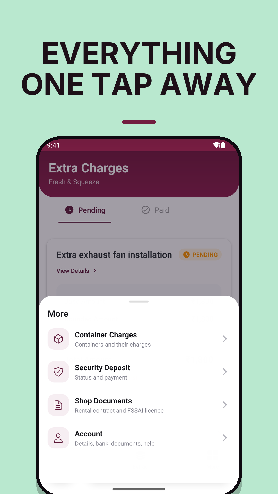 |

## Also in this update (no screenshot)
- 90-day sliding sessions: stay signed in while active; sign-out or a password change ends all sessions.
- Help and support: call or email, hours 9:30 to 4:30 Mon to Sat.
- In-app update prompt (download, then Restart) and a forced-update screen for old builds.
- Festival logos on the login and home screens during major Indian festivals (not shown in store images).
- Modern toasts, directional screen transitions, haptics, new app icon.
- Security: Easebuzz payment responses are signature-verified; double payments are flagged for finance.

## Store notes
- Direct UPI (no gateway screen) is built but depends on Easebuzz enabling Seamless on the merchant account; today payments open the Easebuzz checkout.
- Google sign-in is prepared on iOS but not built or tested there yet; remove it from the iOS text if the iOS build lacks it.
